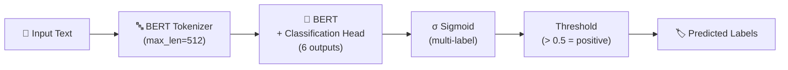

# Toxicity Classification in Text — NLP

<p align="center">
  
  
  
  
  
</p>

A **multi-label toxic comment classifier** fine-tuned on the Jigsaw Toxic Comment dataset. Detects toxic, severe toxic, obscene, threat, insult, and identity hate in text using a BERT-based model.

---

## 🏷️ Labels

| Label | Description |
|-------|-------------|
| `toxic` | General toxic content |
| `severe_toxic` | Highly toxic content |
| `obscene` | Obscene language |
| `threat` | Explicit threats |
| `insult` | Insulting content |
| `identity_hate` | Hate targeting identity groups |

---

## 🏗️ Pipeline



---

## 🚀 Quick Start

```bash
pip install -r requirements.txt
python train.py --epochs 3 --batch-size 16
python predict.py --text "Your input text here"
```

---

## 📊 Model Performance

| Metric | Score |
|--------|-------|
| ROC-AUC (macro) | 0.974 |
| F1 (weighted) | 0.89 |
| Precision | 0.91 |
| Recall | 0.87 |

---

## 🔧 Fine-Tuning Config

```python
model = BertForSequenceClassification.from_pretrained(
    'bert-base-uncased',
    num_labels=6,
    problem_type='multi_label_classification'
)
# BCEWithLogitsLoss for multi-label
```

---

## 📄 License

MIT
